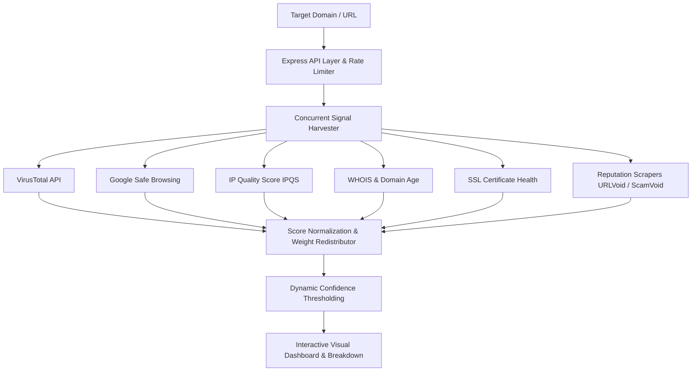

# ScamChecker — Multi-Signal Domain Reputation & Threat Scoring Engine

A domain intelligence and security scoring engine built with **Node.js, Express, and modern JavaScript**. It aggregates threat feeds, SSL analysis, domain age (WHOIS), and reputation services into a weighted trust score with graceful degradation.

---

## What It Solves

Evaluating whether a link or domain is fraudulent typically requires checking multiple isolated platforms (VirusTotal, Google Safe Browsing, IPQS, Trustpilot, ScamAdviser, WHOIS). 

ScamChecker queries these signals concurrently, normalizes disparate scoring scales, and calculates a dynamically re-weighted trust score.

---

## Architecture & Scoring Pipeline



### Dynamic Weight Redistribution

Rather than failing when a third-party API is rate-limited or unavailable, ScamChecker's scoring engine dynamically redistributes missing weights across available services:

$$\text{Adjusted Weight}_i = \frac{\text{Base Weight}_i}{\sum_{j \in \text{Available}} \text{Base Weight}_j}$$

If fewer than two independent intelligence sources respond, the engine explicitly rejects confidence rather than outputting a biased score.

---

## Tech Stack

- **Backend:** Node.js, Express.js
- **Frontend:** Vanilla JS, Vite, CSS Animations
- **Threat Feeds & APIs:** VirusTotal, Google Safe Browsing, IPQualityScore, WHOIS lookup, Node SSL inspection
- **Reliability:** In-memory caching, rate limiting (`express-rate-limit`), input sanitation

---

## Local Setup

### 1. Installation

```bash
git clone https://github.com/mmkaya-ui/scamchecker.git
cd scamchecker
npm install
```

### 2. Environment Variables

Create `.env` with your API keys:

```bash
PORT=3001
VIRUSTOTAL_API_KEY=your_key
SAFE_BROWSING_API_KEY=your_key
IPQS_API_KEY=your_key
```

### 3. Run

```bash
# Start backend and frontend concurrently
npm run dev
```
